# 🩸 BondhOn — Civic Action & Emergency Coordination Platform

🔗 **Live:** [https://bondhon-on.vercel.app](https://bondhon-on.vercel.app/)  
💻 **Repository:** [https://github.com/rk-ripon313/bondhon](https://github.com/rk-ripon313/bondhon)  
👨‍💻 **Developer Portfolio:** [https://rk-ripon313.vercel.app](https://rk-ripon313.vercel.app/)

BondhOn is a community-driven civic action and emergency coordination platform designed to connect people, coordinate local initiatives, and make community support more accessible.

The platform brings together blood donation requests, donor discovery, community events, and location-based coordination to help people take meaningful action and support one another.

### 🏠 Landing Page

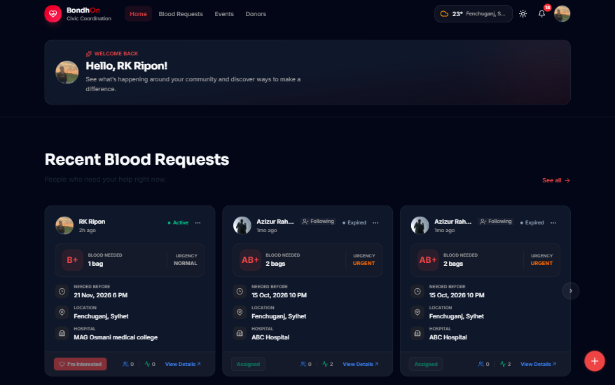

---

## Overview

**BondhOn** is a community-driven civic action and emergency coordination platform built to make blood donation coordination and community participation more accessible, organized, and effective.

Finding compatible blood donors during emergencies can be challenging. Important requests are often scattered across social media platforms, making it difficult to reach the right people at the right time.

BondhOn addresses this problem by providing a structured platform where users can create blood requests, discover potential donors, express interest, and coordinate donation efforts.

Beyond blood donation, BondhOn also supports community engagement through event creation, event discovery, and participation workflows.

The platform brings these activities together in one place, helping people connect and take meaningful action within their communities.

## The Problem

Community-driven emergency responses often depend on disconnected communication channels and manually coordinated activities.

Some common challenges include:

- Difficulty finding compatible blood donors during emergencies.
- Lack of structured blood request management.
- Limited visibility into nearby donor availability.
- Difficulty coordinating interested donors and request owners.
- Community events and volunteer opportunities scattered across different platforms.
- Limited tools for managing community interactions and privacy.

## The Solution

BondhOn provides a centralized platform that brings blood donation coordination and community activities together.

It focuses on:

- **Emergency Coordination:** Structured blood requests and donor coordination workflows.
- **Donor Discovery:** Discover potential donors using blood group, availability, and location-based filters.
- **Donation Coordination:** Express interest in requests and coordinate donor assignments.
- **Community Engagement:** Create, discover, and participate in community events.
- **Location Awareness:** Geographic discovery for relevant requests, donors, and activities.
- **Community Management:** Follow users, manage blocked accounts, and receive activity notifications.

---

## Key Features

### 1. Blood Request Management

A structured workflow for creating, discovering, and managing blood donation requests.

- Create and publish blood requests.
- Browse and search blood requests.
- View detailed request information.
- Filter by blood group, urgency, status, and location.
- Multiple urgency levels:
  - Normal
  - Urgent
  - Critical
- Express interest in blood requests.
- View interested users.
- Coordinate and assign donors.
- Follow blood requests.
- Edit and delete owned requests.
- Request lifecycle states:
  - Active
  - Completed
  - Expired

### 2. Donor Discovery

A dedicated donor directory that helps users discover potential blood donors.

- Verified donor directory.
- Community donor directory.
- Donor profile information.
- Blood group-based filtering.
- Donor availability filtering.
- Search donors.
- Division, district, and upazila filters.
- Location-aware donor discovery.
- Pagination.
- Donor eligibility and availability rules.
- Exclusion of blocked users from relevant discovery results.

### 3. Community Events

A community event management system that enables users to organize and discover local activities.

- Create community events.
- Upload event thumbnails.
- Add event descriptions and categories.
- Define event schedules and locations.
- Browse and search events.
- Filter by category, status, and location.
- View event details and organizer information.
- Going and Interested participation actions.
- Edit and delete owned events.
- Event lifecycle states:
  - Upcoming
  - Ongoing
  - Completed
  - Cancelled

### 4. Authentication & User Profiles

A personalized account system with secure authentication and profile management.

- User registration and login.
- Google authentication.
- Credentials-based authentication.
- Auth.js integration.
- Public user profiles.
- Profile image support.
- Personal information management.
- Medical information.
- Location information.
- Profile completion tracking.
- Donor eligibility requirements.
- Editable profile information.

### 5. Location-Based Discovery

Location-aware functionality helps users discover relevant community activities and donation requests.

- Location initialization.
- Location search.
- Current location detection.
- District and area information.
- Geographic coordinate storage.
- Location-based blood request discovery.
- Location-based donor discovery.
- MongoDB geospatial queries and filtering.

### 6. Notifications

An in-app notification system that keeps users informed about relevant activities.

- Notification center.
- Read and unread notification states.
- Blood request-related notifications.
- Donor assignment notifications.
- Follow-related notifications.
- Event-related notifications.
- Notification navigation.
- Periodic notification polling.
- Notification sound support.

### 7. Community Interaction & Privacy

Features designed to provide users with more control over their community interactions.

- Follow and unfollow users.
- Block and unblock users.
- Blocked users management.
- Privacy settings.
- Exclusion of blocked users from relevant application results.

### 8. Personalized Settings

A responsive settings experience for managing account-related information and preferences.

- Responsive settings navigation.
- Desktop sidebar navigation.
- Mobile-friendly settings navigation.
- Personal information management.
- Privacy settings.
- Blocked users management.
- Dark and light theme support.

### 9. Weather Information

- Weather information through the application interface.
- Location-related weather experience.
- Weather popover integrated into the main navigation.

### 10. Responsive User Experience

- Responsive layouts for mobile, tablet, and desktop.
- Reusable UI components.
- Dark and light theme support.
- Loading states and skeletons.
- Empty states.
- Error and not-found pages.
- Consistent user feedback through toast notifications.

---

## How It Works

### Blood Donation Coordination Workflow

BondhOn organizes the blood request process into a structured coordination flow.

**1. Create a Blood Request**

A user publishes a request with relevant information, including blood group, location, urgency, and required date.

**2. Discover Blood Requests**

Other users can browse requests and use filters to find relevant donation opportunities.

**3. Express Interest**

Potential donors can express interest in helping with a request.

**4. Review Interested Donors**

The request owner can review users who have expressed interest.

**5. Donor Assignment**

The request owner can coordinate and assign a suitable donor.

**6. Request Completion**

The request can be updated through its supported lifecycle, including completion and expiration.

### Community Event Workflow

**1. Create an Event**

An authenticated user can organize a community event by providing its information, schedule, category, and location.

**2. Discover Events**

Community members can explore events through search and location-based filters.

**3. View Event Details**

Users can review event information and organizer details.

**4. Participate**

Users can express their participation through the available Going and Interested actions.

---

## Screenshots

The following screenshots showcase BondhOn's responsive interface and key features across desktop and mobile devices.

### 🏠 Home

|                    Desktop                    |                       Mobile Preview                        |
| :-------------------------------------------: | :---------------------------------------------------------: |
| 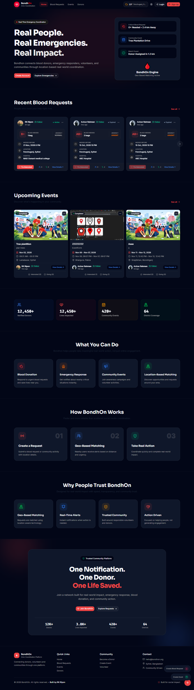 | 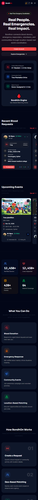 |

### 🩸 Blood Donation

|                      Blood Requests                       |                             Request Details                             |
| :-------------------------------------------------------: | :---------------------------------------------------------------------: |
| 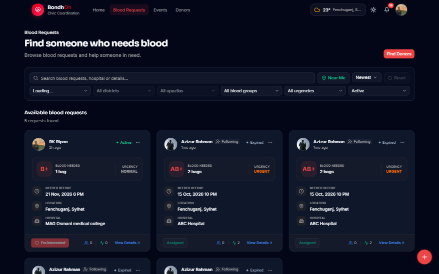 | 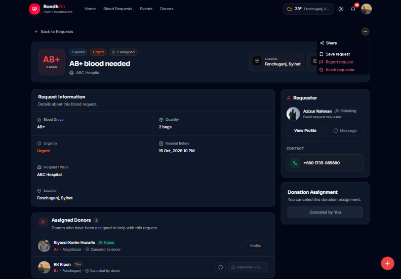 |

### 🔍 Donor Discovery

|                      Desktop                      |                     Mobile                      |
| :-----------------------------------------------: | :---------------------------------------------: |
| 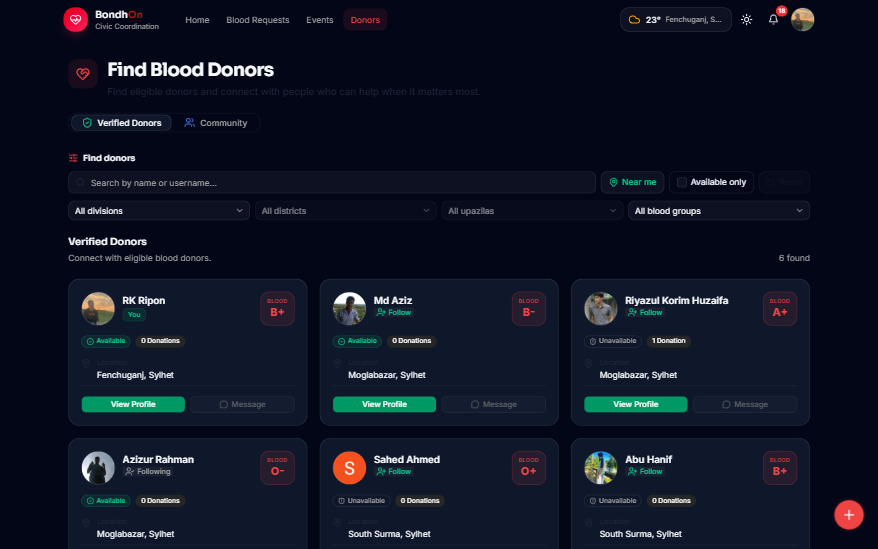 | 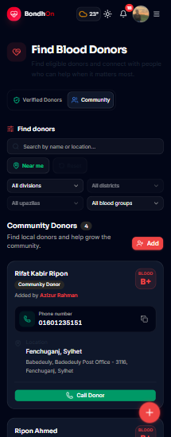 |

### 🎉 Community Events

|                      Events                       |                      Event Details                      |
| :-----------------------------------------------: | :-----------------------------------------------------: |
| 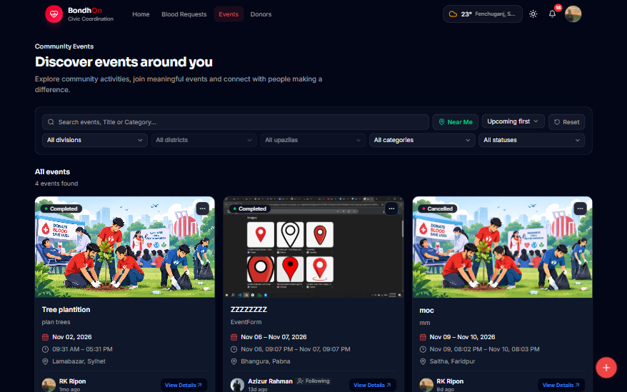 | 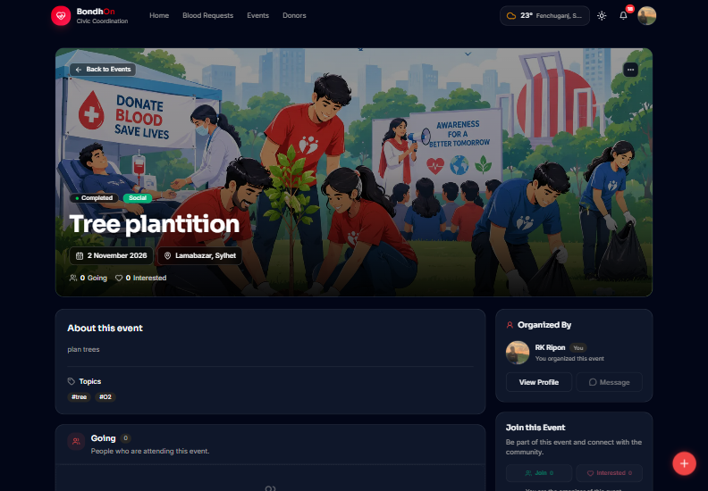 |

### 👤 User Profile & Activity

|                     User Profile                      |                             My Activity & Notifications                             |
| :---------------------------------------------------: | :---------------------------------------------------------------------------------: |
|  | 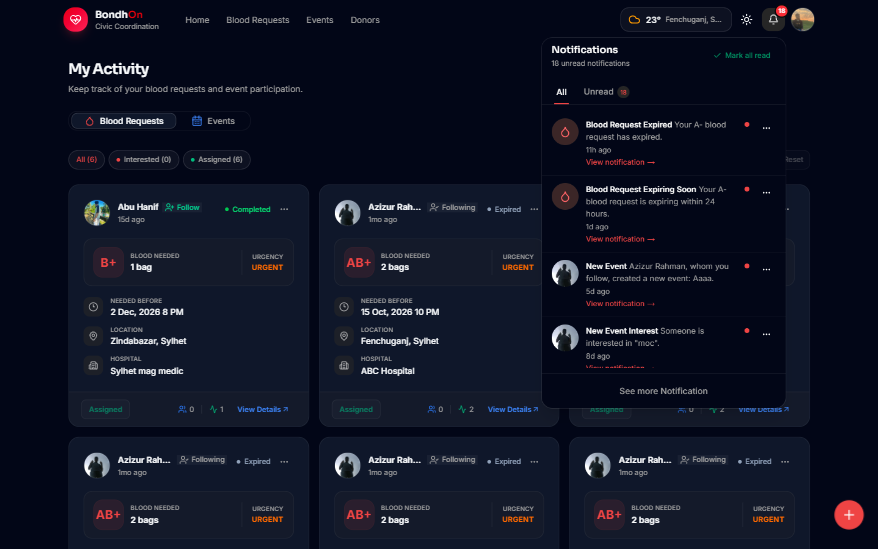 |

### 🔐 Authentication

|                  Login                  |                 Registration                  |
| :-------------------------------------: | :-------------------------------------------: |
| 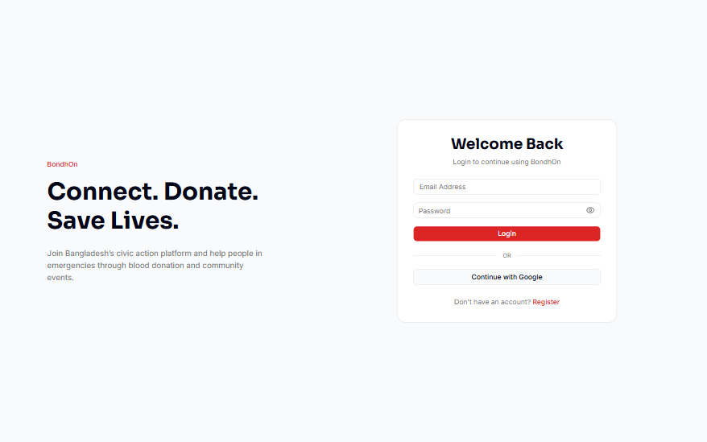 | 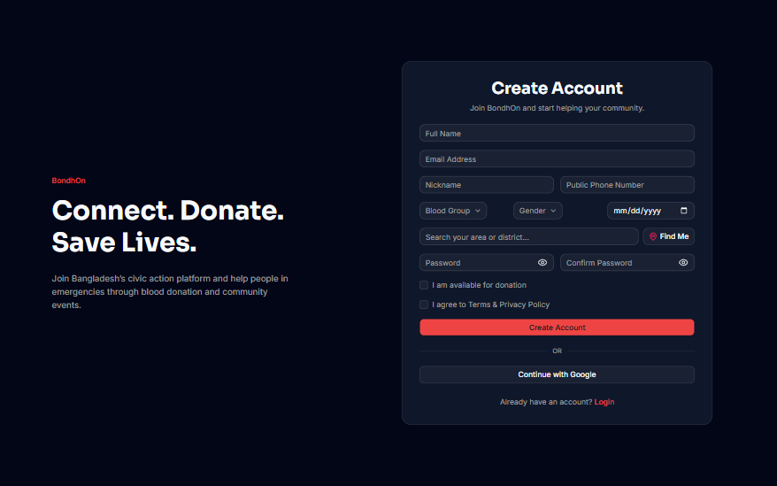 |

### ⚙️ Settings & Privacy

|                       Settings                        |                      Blocked Users                      |
| :---------------------------------------------------: | :-----------------------------------------------------: |
| 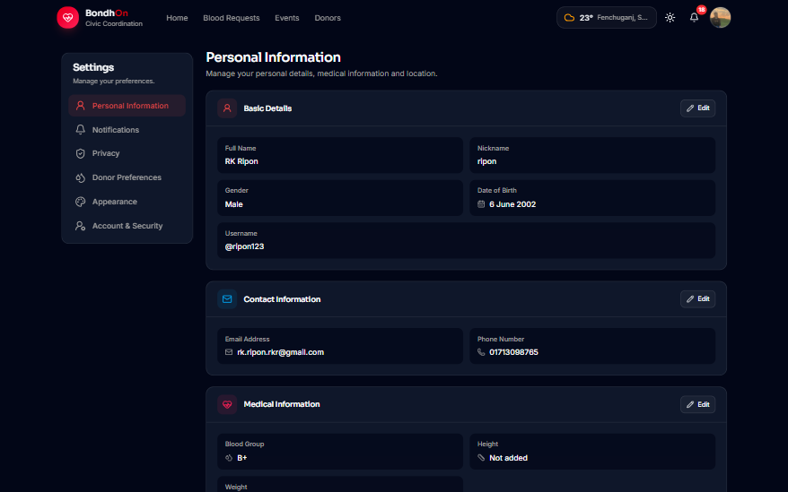 |  |

### 🛠️ Create & Edit Workflows

|                        Create Event                         |                       Edit Event                        |
| :---------------------------------------------------------: | :-----------------------------------------------------: |
| 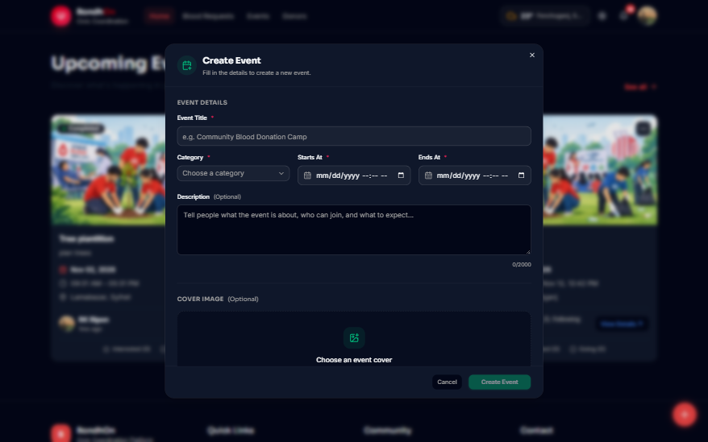 |  |

**Create Blood Request**


### 🔔 Navigation Popovers

|                             Notifications                             |                           Weather                           |
| :-------------------------------------------------------------------: | :---------------------------------------------------------: |
| 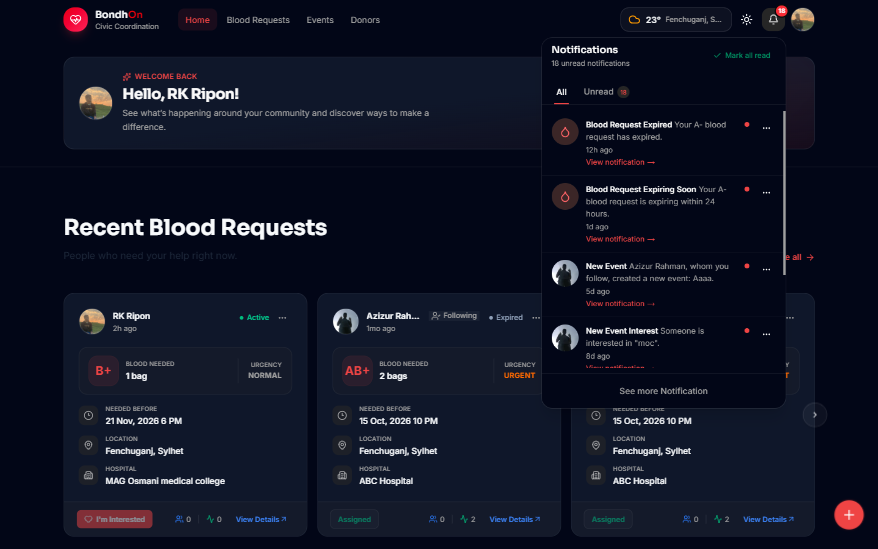 | 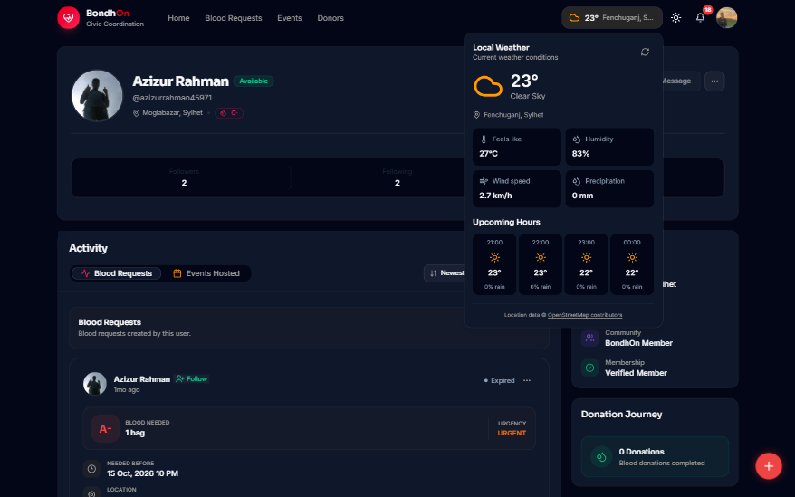 |

---

## Routes & Pages

BondhOn uses the Next.js App Router to organize public pages, authentication pages, user-facing features, settings, and API endpoints.

| Route                  | Description                            |
| ---------------------- | -------------------------------------- |
| `/`                    | Home page                              |
| `/blood-requests`      | Browse and discover blood requests     |
| `/blood-requests/[id]` | Blood request details                  |
| `/donors`              | Verified and community donor directory |
| `/events`              | Browse and discover community events   |
| `/events/[id]`         | Event details and participation        |
| `/user/[username]`     | Public user profile                    |
| `/login`               | User login                             |
| `/register`            | User registration                      |
| `/settings`            | User settings                          |

The application also includes API endpoints for authentication, location-related functionality, and scheduled maintenance tasks.

---

## Technology Stack

BondhOn is built using a modern full-stack JavaScript ecosystem.

| Category               | Technology               |
| ---------------------- | ------------------------ |
| Framework              | Next.js 16 (App Router)  |
| Frontend Library       | React 19                 |
| Programming Language   | TypeScript               |
| Styling                | Tailwind CSS 4           |
| UI Components          | shadcn/ui                |
| Component Primitives   | Radix UI                 |
| Database               | MongoDB                  |
| ODM                    | Mongoose                 |
| Authentication         | Auth.js (NextAuth.js v5) |
| Authentication Adapter | MongoDB Adapter          |
| Form Management        | React Hook Form          |
| Validation             | Zod                      |
| Image Storage          | Cloudinary               |
| Timezone Handling      | date-fns-tz              |
| Notifications          | Sonner                   |
| Deployment             | Vercel                   |

---

## Technical Highlights

### Full-Stack Application Architecture

BondhOn uses the Next.js App Router to build a full-stack application with server-rendered pages, server-side operations, and reusable client-side components.

### Database Management

MongoDB and Mongoose are used for data persistence, schema modeling, and database operations.

### Authentication

Auth.js provides authentication infrastructure with Google and credentials-based sign-in.

### Form Validation

React Hook Form and Zod provide structured form management and input validation.

### Image Management

Cloudinary handles cloud-based image storage and upload workflows, with client-side image compression.

### Geospatial Queries

MongoDB geospatial capabilities support location-aware discovery and geographic filtering.

### Server-Side Operations

Server Actions and API routes handle application operations and data interactions.

### Automated Lifecycle Management

Vercel Cron runs a scheduled maintenance endpoint every day at **02:00 UTC**.

The scheduled task handles:

- Automatically expiring blood requests when their required time has passed.
- Sending reminders for relevant blood requests.
- Updating event statuses based on their scheduled start and end times.

The maintenance endpoint is protected using a `CRON_SECRET` authorization check.

### Timezone-Aware Date Handling

Date and time operations use timezone-aware utilities to handle application scheduling consistently.

---

## Project Structure

The project follows a modular structure to organize application routes, reusable components, database operations, models, and shared utilities.

```text
bondhon/
├── app/
│   ├── (auth)/
│   ├── (main)/
│   ├── (settings)/
│   └── actions/
│   └── api/
│
├── components/
├── constants/
├── database/
│   └── queries/
├── docs/
│   └── images/
├── hooks/
├── lib/
├── models/
├── public/
├── types/
│
├── auth.config.ts
├── auth.ts
├── next.config.ts
├── package.json
├── tsconfig.json
└── vercel.json
```

**Main directories:**

- `app/` — Application routes, layouts, pages, and API endpoints.
- `components/` — Reusable UI and feature components.
- `constants/` — Shared application constants.
- `database/queries/` — Database query operations.
- `docs/` — Project documentation and screenshots.
- `hooks/` — Reusable React hooks.
- `lib/` — Shared utilities, helpers, validation, and application logic.
- `models/` — Mongoose database models.
- `public/` — Static assets.
- `types/` — Shared TypeScript types.

_Note: The structure above highlights the main application areas. Individual files and nested directories may evolve as development continues._

---

## Getting Started

Follow these instructions to run BondhOn locally.

### Prerequisites

Make sure the following tools and services are available:

- Node.js 20.9 or later.
- npm.
- MongoDB database.
- Cloudinary account.
- Google OAuth credentials if Google authentication is enabled locally.

### 1. Clone the Repository

```bash
git clone https://github.com/rk-ripon313/bondhon.git
```

### 2. Navigate to the Project Directory

```bash
cd bondhon
```

### 3. Install Dependencies

```bash
npm install
```

### 4. Configure Environment Variables

Create a `.env.local` file in the root directory.

Configure the environment variables required by the application, including database, authentication, Cloudinary, and cron configuration.

| Variable / Configuration | Purpose                                          |
| ------------------------ | ------------------------------------------------ |
| MongoDB connection       | Database connection                              |
| Auth.js secret           | Authentication security                          |
| Google OAuth credentials | Google sign-in                                   |
| Cloudinary credentials   | Image upload and storage                         |
| Application URL          | Authentication and application URL configuration |
| `CRON_SECRET`            | Protect scheduled maintenance endpoint           |

Use the exact variable names and values from your local configuration. Never commit real credentials or secrets to the repository.

### 5. Run the Development Server

```bash
npm run dev
```

Open the application:

[http://localhost:3000](http://localhost:3000)

### Available Scripts

| Command         | Description                      |
| --------------- | -------------------------------- |
| `npm run dev`   | Start the development server     |
| `npm run build` | Build the production application |
| `npm run start` | Start the production server      |
| `npm run lint`  | Run ESLint                       |

---

## Deployment

BondhOn is deployed using Vercel.

**Production URL:**  
https://bondhon-on.vercel.app/

**Repository:**  
https://github.com/rk-ripon313/bondhon

The project includes a Vercel Cron configuration for scheduled maintenance tasks.

For production deployment:

1. Import the repository into Vercel.
2. Configure the required environment variables.
3. Connect the MongoDB database.
4. Configure Cloudinary and Google OAuth credentials.
5. Set the `CRON_SECRET` environment variable.
6. Deploy the application.

The scheduled maintenance endpoint is configured through `vercel.json`.

---

## Security & Data Handling

BondhOn includes authentication, structured input validation, and user-related access controls as part of its application architecture.

Key areas include:

- Auth.js-based authentication.
- Server-side application operations.
- Zod-based input validation.
- User profile and ownership-related workflows.
- Blocked-user handling.
- Protected scheduled maintenance endpoint.
- MongoDB-backed data management.

**Responsible Use:** BondhOn supports community blood donation coordination. It does not replace medical advice, professional healthcare services, hospital procedures, or official emergency services.

---

## Future Improvements

Areas for continued development and improvement include:

- Complete end-to-end donation confirmation and donation history workflows.
- Further improve event participation management.
- Expand notification preferences and user controls.
- Complete remaining account and donor preference settings.
- Improve centralized cleanup of related notifications.
- Expand application testing and accessibility.
- Improve technical documentation and architecture references.

---

## About the Developer

**RK Ripon**  
Junior Frontend Developer | Full-Stack Developer

BondhOn is an independent full-stack project built to explore practical problem-solving through modern web technologies, real-world workflows, and community-focused application development.

**Connect with me:**

- GitHub: [rk-ripon313](https://github.com/rk-ripon313)
- Portfolio: [rk-ripon313.vercel.app](https://rk-ripon313.vercel.app/)
- LinkedIn: [rk-ripon313](https://www.linkedin.com/in/rk-ripon313)

---

## Acknowledgements

BondhOn is made possible by the open-source technologies and services used throughout its development.

Special thanks to the maintainers and contributors of the tools and libraries that support the modern web development ecosystem.

---

<div align="center">

### BondhOn

**Connecting People. Coordinating Actions. Building Stronger Communities.**

[Live Application](https://bondhon-on.vercel.app/) · [GitHub Repository](https://github.com/rk-ripon313/bondhon)

</div>
